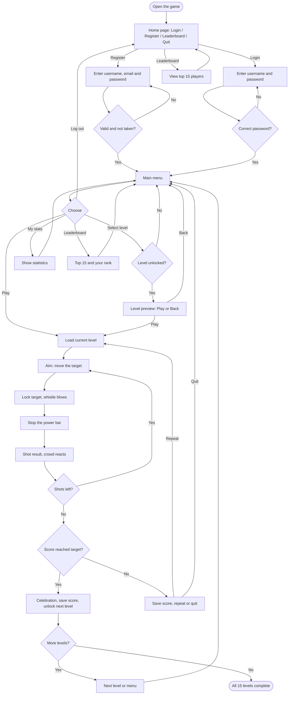
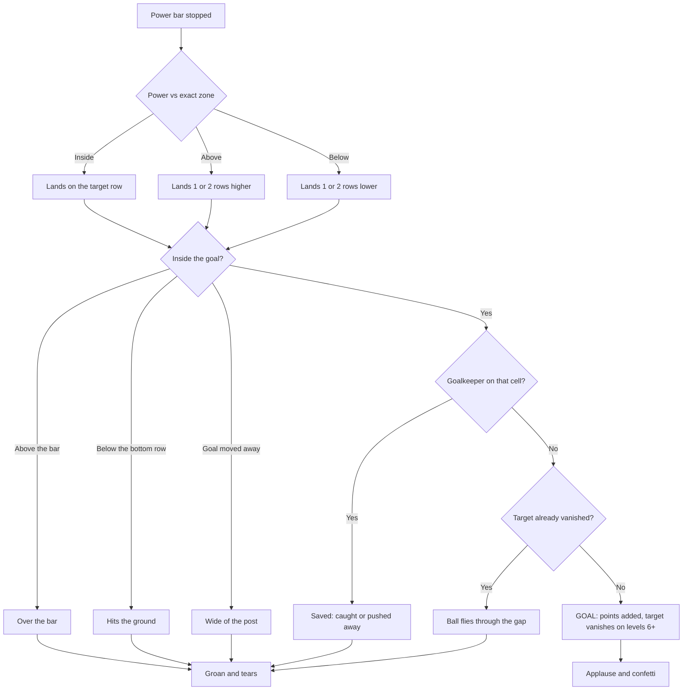
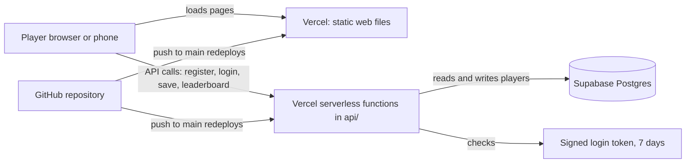

# ⚽ Football Shootout — Football Shooting Game in C and JavaScript

A football shooting game with two versions: a **terminal game in C** (Windows) and an **online web game** you can play from anywhere, on desktop or phone. Aim at regions of the goal, time your shot power, beat the goalkeeper, and clear 15 levels while a crowd cheers, claps or cries behind the goal.

## 🌍 Play Online

**👉 [Play now: football-game-in-c.vercel.app](https://football-game-in-c.vercel.app)**

- Works on desktop (keyboard) and on phones (on-screen touch buttons).
- Create an account with a username, email and password, and your progress is saved online.
- A helper sticker gives tips on every screen. Drag it anywhere, or tap it to hide the speech bubble.
- Sound effects play after your first click or key press. Use the 🔊 button in the top-right corner to mute.
- On a phone, turn the screen sideways for a bigger goal, and use *Add to Home screen* in your browser menu to open it like an app.

**Links**

| What | Link |
|---|---|
| Play the game | https://football-game-in-c.vercel.app |
| Leaderboard data (JSON) | https://football-game-in-c.vercel.app/api/leaderboard |
| Source code | https://github.com/adilmahmudayon-hue/Football-game-in-C |

---

## 📌 Table of Contents

- [Overview](#-overview)
- [Features](#-features)
- [How to Play](#-how-to-play)
- [Workflow](#-workflow)
- [Levels and Ranks](#-levels-and-ranks)
- [Leaderboard](#-leaderboard)
- [Project Structure](#-project-structure)
- [Run the Web Version Locally](#-run-the-web-version-locally)
- [Build the Console Version](#-build-the-console-version)
- [Deploying Your Own Copy](#-deploying-your-own-copy)
- [Data Storage](#-data-storage)
- [Technologies Used](#-technologies-used)
- [Future Improvements](#-future-improvements)
- [Author](#-author)

## 🎮 Overview

Players register or log in, pick a level, aim at a cell inside the goal and stop a power bar. The power decides how high the ball lands compared to the target. The game awards points and checks whether the player reached the target score to unlock the next level.

The C version follows a modular approach, with separate modules for the goal, input, players, levels, power and utilities. The web version uses the same game rules, with accounts stored in an online database and the API running as serverless functions.

## ✨ Features

### Both versions

- Player accounts: registration and login
- 9x4 goal with a points grid (corners and edges are worth the most)
- Power bar that controls the height of the shot
- 15 levels with 3 shots each and a target score
- Ranks: Beginner, Easy, Medium, Hard and Pro
- **Goalkeeper** from level 4. He slides across the goal, catches shots on his middle column and pushes them away on his sides. He is faster and taller on higher levels.
- **Vanishing targets** from level 6: a target you score on disappears for the rest of the level
- **Moving goal** from level 11: the goal slides left and right, so you have to aim ahead of it
- Level select with locked levels and a Play / Back preview
- Saved high score, total score, games played and current level

### Console version

- ANSI colors and a text-based ball flight animation
- Accounts saved locally in `data/players.txt`

### Web version

- Canvas graphics: goal, net, grass, goalkeeper, power bar and animated ball
- **Crowd** behind the goal that sways while you aim, jumps with confetti when you score, and cries when you miss
- **Sound effects:** a referee whistle before every shot, applause and a cheer on a goal, groans and sobs on a miss, and a big celebration when you pass a level. A mute button remembers your choice.
- **Helper sticker** with tips that change on every screen and follow the game while you play
- Home page with options only (Login, Register, Leaderboard, Quit), and separate Login and Register forms
- Registration with **username, email and password**
- Touch controls for phones
- Online accounts with **hashed passwords** stored in a Supabase (Postgres) database
- Leaderboard with your own rank highlighted
- Quit level button during play

## 🕹️ How to Play

1. Register an account or log in.
2. Choose **Play** to continue, or **Select level** to pick an unlocked level.
3. Move the target over the goal.
4. Lock the target. The referee whistles.
5. Stop the power bar.
6. Reach the target score before you run out of shots to unlock the next level.

### Controls

| Action | Keyboard | Phone |
|---|---|---|
| Move target | Arrow keys | Arrow buttons |
| Lock target | Enter | LOCK / SHOOT |
| Stop power bar | Space or Enter (any key in console) | LOCK / SHOOT |
| Quit level | Esc (Q in console) | Quit level button |
| Sound on/off | 🔊 button (web) | 🔊 button (web) |

### Shot outcomes

| Power | Result |
|---|---|
| In the exact zone | The ball lands on your target. |
| Above the zone | The ball lands 1 or 2 rows higher and may still score. |
| Below the zone | The ball lands 1 or 2 rows lower and may still score. |
| Top-row target, too much power | Over the bar, no points. |
| Bottom-row target, too little power | Hits the ground, no points. |
| Lands on the goalkeeper | Caught or pushed away, no points. The target does not vanish. |
| Lands on a vanished target | The ball flies through the gap, no points. |
| Goal has moved away (levels 11+) | The ball goes wide, no points. |

## 🔄 Workflow

### 1. Player flow



### 2. What happens to each shot



### 3. How the online system works



## 🏆 Levels and Ranks

| Level | Rank | Target | Bar speed | Exact zone | Mechanics |
|---|---|---|---|---|---|
| 1 | Beginner | 5 | 2 | 35% - 70% | none |
| 2 | Beginner | 7 | 3 | 40% - 70% | none |
| 3 | Beginner | 9 | 3 | 45% - 70% | none |
| 4 | Easy | 11 | 4 | 50% - 70% | goalkeeper |
| 5 | Easy | 12 | 5 | 55% - 70% | goalkeeper |
| 6 | Easy | 9 | 5 | 58% - 70% | + vanishing targets |
| 7 | Medium | 10 | 5 | 60% - 70% | + vanishing targets |
| 8 | Medium | 11 | 6 | 62% - 72% | + vanishing targets |
| 9 | Medium | 12 | 6 | 64% - 72% | + vanishing targets |
| 10 | Hard | 13 | 7 | 64% - 72% | taller goalkeeper |
| 11 | Hard | 9 | 6 | 64% - 74% | + moving goal |
| 12 | Hard | 10 | 6 | 64% - 74% | + moving goal |
| 13 | Pro | 11 | 7 | 66% - 74% | + faster moving goal |
| 14 | Pro | 12 | 7 | 66% - 74% | + faster moving goal |
| 15 | Pro | 13 | 7 | 68% - 76% | fastest goal and goalkeeper |

## 📊 Leaderboard

The web leaderboard shows the **top 15 players**, ranked by **level reached**, then by **total score**. Your own row is highlighted, and a box at the bottom shows your position out of all players, even if you are outside the top 15.

## 📂 Project Structure

```text
Football-game-in-C/
├── src/main.c            console game: menus and level loop
├── goal/                 goal, goalkeeper, vanishing targets, animation
├── input/                keyboard input
├── level/                level settings and rank names
├── player/               accounts, stats, leaderboard (console)
├── power/                power bar and shot evaluation
├── utils/                console and timing helpers
├── web/                  web game (static files)
│   ├── index.html
│   ├── style.css
│   ├── game.js           canvas game, crowd and goalkeeper
│   ├── levels.js         level data
│   ├── menu.js           login, register, menus, touch controls, helper sticker
│   ├── sound.js          sound effects (Web Audio, no audio files)
│   └── sticker*.png      helper sticker image
├── api/                  serverless API (Vercel)
│   ├── register.js
│   ├── login.js
│   ├── logout.js
│   ├── save.js
│   └── leaderboard.js
├── lib/common.js         shared API code: database, signed tokens, validation
├── auth.js               password hashing
├── vercel.json           tells Vercel to serve the web/ folder
├── package.json
├── data/                 console game saves (not uploaded)
└── README.md
```

## 💻 Run the Web Version Locally

Requirements: Node.js, a free Supabase project (see [Deploying Your Own Copy](#-deploying-your-own-copy)) and the Vercel CLI.

```powershell
npm install
npx vercel dev
```

Set `SUPABASE_URL`, `SUPABASE_SERVICE_KEY` and `SESSION_SECRET` first (in a local `.env` file that is not committed, or with `vercel env pull`). Never commit these values.

## 🖥️ Build the Console Version

Requirements: Windows, GCC (MinGW), and a terminal with ANSI color support (VS Code terminal or Windows Terminal).

```powershell
gcc src/main.c goal/goal.c input/input.c utils/utils.c player/player.c level/level.c power/power.c -Igoal -Iinput -Iutils -Iplayer -Ilevel -Ipower -o game.exe
.\game.exe
```

Run it from the repository root so the `data/` folder is created there.

## ☁️ Deploying Your Own Copy

The game is hosted on [Vercel](https://vercel.com). The `web/` folder is served as static files and the `api/` folder runs as serverless functions.

1. Create a Supabase project and run this in its SQL Editor:

```sql
create table players (
  name text primary key,
  email text,
  password_hash text not null,
  high_score int not null default 0,
  games_played int not null default 0,
  total_score int not null default 0,
  level int not null default 1
);
create unique index players_email_unique on players (email);
alter table players enable row level security;
```

2. Create a random session secret:

```powershell
node -e "console.log(require('crypto').randomBytes(32).toString('hex'))"
```

3. On Vercel, import your GitHub repo as a new project. Set the framework preset to **Other**, and leave the build command empty (`vercel.json` points the output to `web`).
4. Add these environment variables in Vercel:

| Key | Value |
|---|---|
| `SUPABASE_URL` | your Supabase project URL |
| `SUPABASE_SERVICE_KEY` | your Supabase **secret** key |
| `SESSION_SECRET` | the random string from step 2 |

5. Click **Deploy**. Keep the secret key and session secret private, and never commit them to the repository.

## 💾 Data Storage

- **Web version:** players are stored in a Supabase Postgres table. Passwords are hashed with scrypt and salted. Logins use signed tokens that expire after 7 days, so players stay logged in across redeploys. Emails are stored for account contact only, are not verified, and are never shown to other players.
- **Console version:** players are stored locally in `data/players.txt`, which is not uploaded to GitHub.
- The two versions keep **separate accounts and scores**. An account created on the website cannot be used in the console game, and the other way round.

## 🛠️ Technologies Used

- **C** and **GCC (MinGW)** for the console game
- **ANSI escape sequences** and Windows console APIs for terminal graphics and input
- **HTML5 canvas, CSS and JavaScript** for the web game
- **Web Audio API** for generated sound effects
- **Node.js** serverless functions for the API
- **Supabase (Postgres)** for online data storage
- **Vercel** for hosting
- **Git and GitHub** for version control

## 🔮 Future Improvements

- [ ] Change password and forgot password by email
- [ ] Rank shown in the web in-game display
- [ ] Sound for a failed level
- [ ] Screenshots and a gameplay demo
- [ ] Shared accounts between the console and web versions
- [ ] Add a license

## 👨‍💻 Author

**Adil Mahmud Ayon**

- GitHub: [@adilmahmudayon-hue](https://github.com/adilmahmudayon-hue)
- Project: [Football-game-in-C](https://github.com/adilmahmudayon-hue/Football-game-in-C)

---

⭐ If you like this project, consider starring the repository!

**Built with C, JavaScript and a passion for football. ⚽**