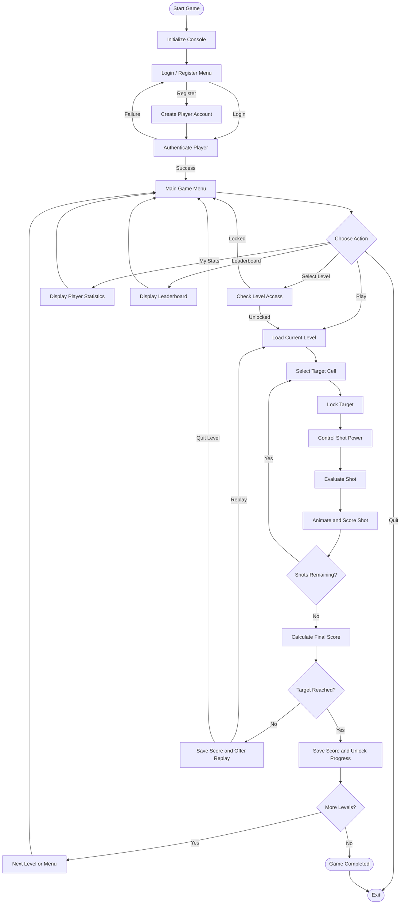

# ⚽ Football Shootout — A Terminal-Based Game in C

A modular, terminal-based football shooting game developed in **C**. Aim at different regions of the goal, control your shot power, earn points, unlock levels, and compete for a place on the leaderboard.

**Repository:** [Football-game-in-C](https://github.com/adilmahmudayon-hue/Football-game-in-C)

---

## 📌 Table of Contents

- [Overview](#-overview)
- [Features](#-features)
- [Gameplay](#-gameplay)
- [Game Workflow](#-game-workflow)
- [Project Structure](#-project-structure)
- [Module Responsibilities](#-module-responsibilities)
- [Technologies Used](#-technologies-used)
- [Installation and Execution](#-installation-and-execution)
- [Programming Concepts](#-programming-concepts)
- [Future Improvements](#-future-improvements)
- [Author](#-author)
- [License](#-license)

## 🎮 Overview

Football Shootout is an interactive football shooting game that combines precision aiming, power timing, score calculation, and level-based progression.

Players can register or log in, select a level, aim at a specific position inside the goal, and control the power of each shot. The game evaluates the result, awards points when appropriate, and determines whether the player has achieved the required score to unlock the next level.

The project follows a **modular programming approach**, separating the main game logic from goal rendering, keyboard input, player management, level configuration, power control, and utility functions.

## ✨ Features

- **Player accounts:** Registration and login.
- **Interactive aiming:** Move around the goal using arrow keys and confirm a target.
- **Power-bar mechanics:** Control shot strength to influence the ball's landing position.
- **Shot animation:** View the result of each attempt.
- **Scoring system:** Earn points according to shot outcomes and landing positions.
- **Multiple levels:** Play levels with different shot limits, target scores, and power zones.
- **Progression system:** Unlock new levels by completing previous ones.
- **Replay functionality:** Retry a level after an unsuccessful attempt.
- **Player statistics:** View personal game information.
- **Leaderboard:** Compare recorded scores with other players.
- **Terminal interface:** Navigate menus and play using keyboard input.

## 🕹️ Gameplay

1. Launch the game and choose Login, Register, Leaderboard, or Quit.
2. After successful authentication, enter the main game menu.
3. Continue from the current level or select an unlocked level.
4. Review the level's shot limit, target score, and ideal power range.
5. Use the arrow keys to select a target inside the goal.
6. Press Enter to lock the target.
7. Control the power bar to determine the shot's strength.
8. Observe the shot animation and receive feedback.
9. Earn points and try to reach the target score before running out of shots.
10. Unlock the next level or replay the current one, depending on the result.

### Scoring outcomes

| Shot result | Outcome |
|---|---|
| Perfect hit | The ball reaches the selected target and earns its points. |
| Too much power | The ball lands higher than the selected target and may still score. |
| Too little power | The ball lands lower than the selected target and may still score. |
| Over the bar | No points. |
| Too weak to reach the goal | No points. |

A level is completed when the final score meets or exceeds its target score.

## 🔄 Game Workflow

The game follows this sequence from launch to level progression.



### How the modules cooperate

- `main.c` controls the application flow and calls functions from the other modules.
- The `player` module manages account-related operations, statistics, score recording, and progress.
- The `level` module provides the configuration for the selected level.
- The `goal` module handles the goal display and target-point calculation.
- The `input` module reads keyboard actions.
- The `power` module handles the power bar, shot evaluation, and shot animation.
- The `utils` module provides shared console and utility operations.

## 📂 Project Structure

The repository separates the application entry point from the modules responsible for individual game systems.

```text
Football-game-in-C/
│
├── src/
│   └── main.c
│
├── goal/
│   ├── goal.c
│   └── goal.h
│
├── input/
│   ├── input.c
│   └── input.h
│
├── level/
│   ├── level.c
│   └── level.h
│
├── player/
│   ├── player.c
│   └── player.h
│
├── power/
│   ├── power.c
│   └── power.h
│
├── utils/
│   ├── utils.c
│   └── utils.h
│
├── .gitignore
└── README.md
```

*The tree documents the intended module pairing. Confirm individual filenames against the contents of each folder before using the compilation command below.*

### Why separate `.c` and `.h` files?

- **`.c` files** contain the actual function implementations and logic.
- **`.h` files** declare functions, structures, enumerations, and constants that other modules need to access.
- **`src/main.c`** coordinates the modules through their public interfaces.

This separation makes the project easier to maintain, test, debug, and extend.

## 🧩 Module Responsibilities

| Module | Responsibility |
|---|---|
| `src/main.c` | Main menus, login flow, aiming, gameplay, level selection, and progression |
| `goal/` | Goal rendering and target-point calculation |
| `input/` | Keyboard input and key-event handling |
| `level/` | Level settings, shot limits, target scores, and power zones |
| `player/` | Registration, login, player statistics, leaderboard, score recording, and progress |
| `power/` | Power-bar operation, shot evaluation, and shot animation |
| `utils/` | Console initialization, screen clearing, cursor control, and timing utilities |

## 🛠️ Technologies Used

- **C:** Main programming language.
- **GCC:** Compiler.
- **Standard C library:** Input/output, strings, and formatted output.
- **ANSI escape sequences:** Terminal screen and cursor control.
- **Git and GitHub:** Version control and source code hosting.

## 🚀 Installation and Execution

### Prerequisites

- GCC or another compatible C compiler.
- Git, for cloning the repository.
- A terminal that supports the game's keyboard input and console features.

Check your GCC installation:

```bash
gcc --version
```

### 1. Clone the repository

```bash
git clone https://github.com/adilmahmudayon-hue/Football-game-in-C.git
```

### 2. Open the project directory

```bash
cd Football-game-in-C
```

### 3. Compile the project

From the repository root, if the source files are named as shown in the project tree:

```bash
gcc -std=c11 -Wall -Wextra src/main.c goal/goal.c input/input.c level/level.c player/player.c power/power.c utils/utils.c -Igoal -Iinput -Ilevel -Iplayer -Ipower -Iutils -o football
```

The `-I` options tell GCC where to find the header files included by `main.c`.

The `-Wall` and `-Wextra` options enable additional compiler warnings.

**Note:** This command assumes each module's implementation file has the matching name shown above. If a folder contains additional required `.c` files, include those in the command as well.

### 4. Run the game

**Windows PowerShell:**

```powershell
.\football.exe
```

**Linux:**

```bash
./football
```

If keyboard handling relies on platform-specific APIs, the compiler and terminal setup may need additional configuration.

## 🧠 Programming Concepts

The project demonstrates several fundamental C programming concepts:

- **Functions and modular programming:** Separate gameplay responsibilities into reusable functions and modules.
- **Structures and enumerations:** Organize player and level data and represent shot outcomes.
- **Pointers:** Allow functions to modify target coordinates and share data.
- **Conditionals and loops:** Handle menus, shot evaluation, level completion, and replay logic.
- **Arrays and strings:** Manage target positions, formatted messages, and player-related information.
- **Input/output and file handling:** Process keyboard input, display results, and support persistent game data where implemented.
- **Console control:** Use terminal escape sequences and timing utilities for interactive effects.

## 🔮 Future Improvements

- [ ] Add additional levels and goal layouts.
- [ ] Introduce practice and difficulty modes.
- [ ] Add sound effects and improved animations.
- [ ] Expand player statistics and historical score tracking.
- [ ] Improve input validation and account-data handling.
- [ ] Enhance portability across terminal environments.
- [ ] Add screenshots or a gameplay demonstration.

## 👨‍💻 Author

**Adil Mahmud Ayon**

- GitHub: [@adilmahmudayon-hue](https://github.com/adilmahmudayon-hue)
- Project: [Football-game-in-C](https://github.com/adilmahmudayon-hue/Football-game-in-C)

## 📄 License

Please refer to the license included in the repository. If the project does not yet have a license, consider adding one to define the terms under which others may use, modify, and distribute the code.

---

⭐ If you like this project, consider starring the repository!

**Built with C and a passion for football. ⚽**
