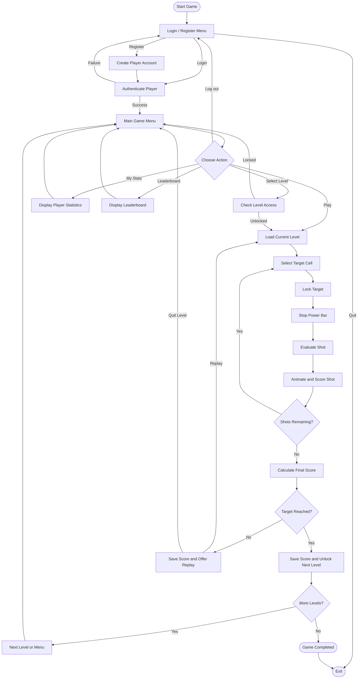

# ⚽ Football Shootout — A Football Shooting Game in C and JavaScript

A modular football shooting game with two versions that share the same player data: a **terminal game in C** (Windows) and a **web game** (HTML canvas + JavaScript) served by a small Node.js server. Aim at regions of the goal, time your shot power, beat the goalkeeper, and clear 15 levels.

**Repository:** [Football-game-in-C](https://github.com/adilmahmudayon-hue/Football-game-in-C)

**Play the web version:** http://localhost:3000 (runs on your own PC, see [Web Version](#-web-version))

---

## 📌 Table of Contents

- [Overview](#-overview)
- [Features](#-features)
- [Gameplay](#-gameplay)
- [Levels and Ranks](#-levels-and-ranks)
- [Game Workflow](#-game-workflow)
- [Project Structure](#-project-structure)
- [Module Responsibilities](#-module-responsibilities)
- [Technologies Used](#-technologies-used)
- [Installation and Execution](#-installation-and-execution)
- [Web Version](#-web-version)
- [Data Storage](#-data-storage)
- [Programming Concepts](#-programming-concepts)
- [Future Improvements](#-future-improvements)
- [Author](#-author)
- [License](#-license)

## 🎮 Overview

Football Shootout combines precision aiming, power timing, a goalkeeper, score calculation and level-based progression.

Players register or log in, pick a level, aim at a cell inside the goal and stop a power bar. The power decides how high the ball lands relative to the target. The game awards points and checks whether the player reached the target score to unlock the next level.

The C version follows a **modular programming approach**, separating the main game flow from goal rendering, keyboard input, player management, level configuration, power control and utilities. The web version reuses the same game rules and the same `players.txt` file, so one account works in both.

## ✨ Features

### Both versions

- **Player accounts:** registration and login.
- **Interactive aiming:** move across a 9x4 goal with the arrow keys and lock a target.
- **Power bar:** stopping the bar controls the height of the shot.
- **Scoring grid:** corners and edges are worth the most.
- **15 levels** with 3 shots each, a target score and a tighter power zone as levels rise.
- **Difficulty ranks:** Beginner, Easy, Medium, Hard and Pro.
- **Level select:** locked levels tell you which level to complete first, and a preview screen offers Play or Back.
- **Progression:** unlock the next level by reaching the target score, or repeat a failed level.
- **Saved stats:** high score, total score, games played and current level.
- **Leaderboard:** top players by high score.
- **Quit and log out** options.

### Console version

- **Ball flight animation** with ANSI colors.
- **Goalkeeper** from level 4. He slides across the goal, catches shots on his middle column and pushes them away on his sides. He gets faster and taller on higher levels.
- **Vanishing targets** from level 6: a target you score on disappears.
- **Moving goal** from level 11: the goal slides left and right, so you have to aim ahead of it.

### Web version

- Canvas graphics: goal, net, grass, power bar and animated ball.
- Quit level button (or Esc) during play.
- Accounts and scores saved by the Node server in `data/players.txt`.
- Goalkeeper, vanishing targets and moving goal are not in the web version yet.

## 🕹️ Gameplay

1. Launch the game and choose Login, Register, Leaderboard or Quit.
2. After logging in, open the main menu: Play, Select level, My stats, Leaderboard, Log out.
3. Continue from your current level or pick any unlocked level.
4. Review the level's shots, target score and exact power zone.
5. Use the arrow keys to select a target inside the goal.
6. Press Enter to lock the target.
7. Stop the power bar with a key press.
8. Watch the shot and read the feedback.
9. Reach the target score before you run out of shots.
10. Unlock the next level or repeat the current one.

### Shot outcomes

| Shot result | Outcome |
|---|---|
| Power in the exact zone | The ball lands on your target and earns its points. |
| Power above the zone | The ball lands 1 or 2 rows higher and may still score. |
| Power below the zone | The ball lands 1 or 2 rows lower and may still score. |
| Top-row target with too much power | Over the bar, no points. |
| Bottom-row target with too little power | Hits the ground before the goal, no points. |
| Lands on the goalkeeper (console) | Caught or pushed away, no points. |
| Goal moved away (console, levels 11+) | Missed wide, no points. |

A level is completed when the final score meets or exceeds its target score.

## 🏆 Levels and Ranks

| Level | Rank | Target | Bar speed | Exact zone | Extra mechanics (console) |
|---|---|---|---|---|---|
| 1 | Beginner | 5 | 2 | 35% - 70% | none |
| 2 | Beginner | 7 | 3 | 40% - 70% | none |
| 3 | Beginner | 9 | 3 | 45% - 70% | none |
| 4 | Easy | 11 | 4 | 50% - 70% | goalkeeper |
| 5 | Easy | 12 | 5 | 55% - 70% | goalkeeper |
| 6 | Easy | 9 | 5 | 58% - 70% | + vanishing targets |
| 7 | Medium | 10 | 5 | 60% - 70% | + vanishing targets |
| 8 | Medium | 11 | 6 | 62% - 72% | + vanishing targets |
| 9 | Medium | 12 | 6 | 64% - 72% | + vanishing targets |
| 10 | Hard | 13 | 7 | 64% - 72% | taller goalkeeper |
| 11 | Hard | 9 | 6 | 64% - 74% | + moving goal |
| 12 | Hard | 10 | 6 | 64% - 74% | + moving goal |
| 13 | Pro | 11 | 7 | 66% - 74% | + faster moving goal |
| 14 | Pro | 12 | 7 | 66% - 74% | + faster moving goal |
| 15 | Pro | 13 | 7 | 68% - 76% | fastest goal and keeper |

## 🔄 Game Workflow



### How the modules cooperate

- `main.c` controls the application flow and calls the other modules.
- `player` handles accounts, statistics, score recording and progress.
- `level` provides each level's settings and its rank name.
- `goal` draws the goal, the goalkeeper and the ball animation, and handles vanishing targets and the moving goal.
- `input` reads keyboard actions.
- `power` runs the power bar and decides where the shot lands.
- `utils` provides console and timing helpers.

## 📂 Project Structure

```text
Football-game-in-C/
│
├── src/
│   └── main.c
│
├── goal/
│   ├── goal.c
│   └── goal.h
│
├── input/
│   ├── input.c
│   └── input.h
│
├── level/
│   ├── level.c
│   └── level.h
│
├── player/
│   ├── player.c
│   └── player.h
│
├── power/
│   ├── power.c
│   └── power.h
│
├── utils/
│   ├── utils.c
│   └── utils.h
│
├── web/
│   ├── index.html
│   ├── style.css
│   ├── game.js
│   ├── levels.js
│   └── menu.js
│
├── data/              (created automatically, not uploaded to GitHub)
│   └── players.txt
│
├── server.js
├── .gitignore
└── README.md
```

### Why separate `.c` and `.h` files?

- **`.c` files** contain the function implementations and logic.
- **`.h` files** declare the functions, structures, enumerations and constants other modules need.
- **`src/main.c`** coordinates the modules through their public interfaces.

This makes the project easier to maintain, test, debug and extend.

## 🧩 Module Responsibilities

| Module | Responsibility |
|---|---|
| `src/main.c` | Menus, login flow, aiming, level loop, level select and progression |
| `goal/` | Goal grid, drawing, goalkeeper, vanishing targets, moving goal, ball animation |
| `input/` | Keyboard input and key-event handling |
| `level/` | Level settings (shots, target, bar speed, zone, mechanics) and rank names |
| `player/` | Registration, login, statistics, leaderboard, score recording and progress |
| `power/` | Power bar and shot evaluation (exact, higher, lower, over, under) |
| `utils/` | Console